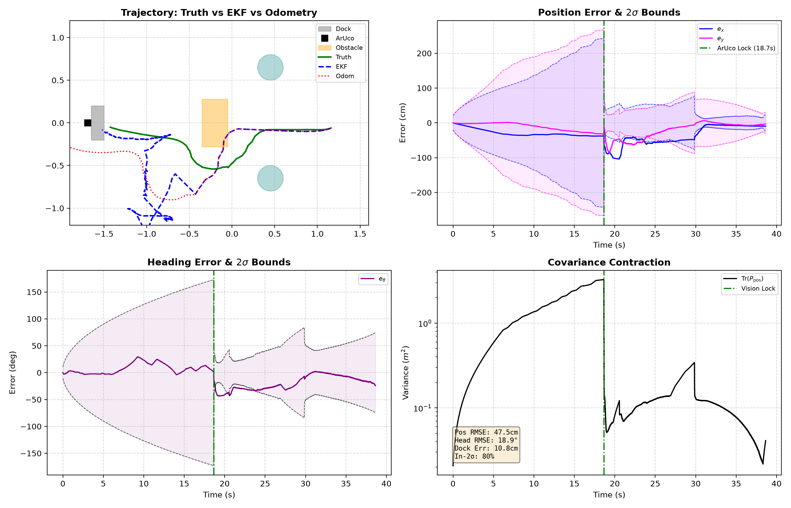
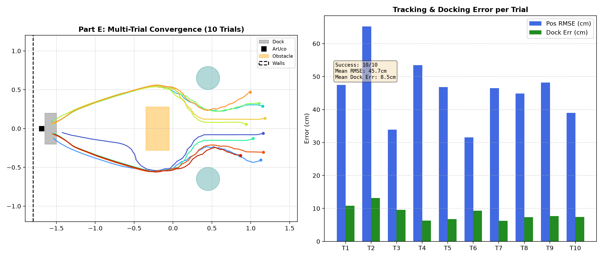
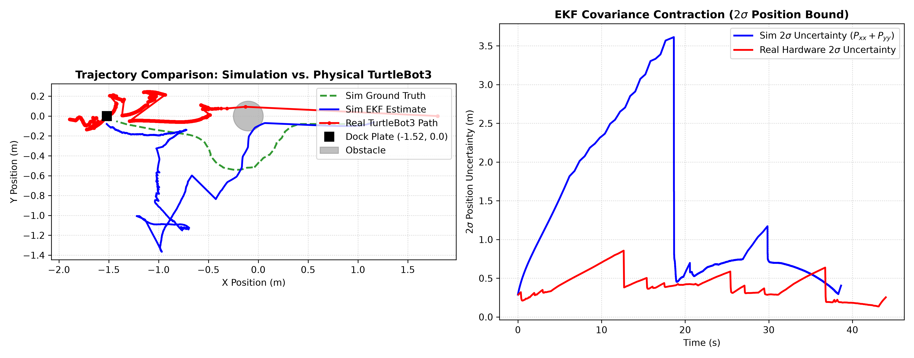

# 41014 Sensors and Control: Integrated Project

**Track A:** TurtleBot3 Mobile Robot Visual Waypoint Navigation  
**Group:** [Insert Group Number]  
**Members:** Rowan O'Meara ([Student ID]), [Team Member 2], [Team Member 3]  
**Video Demo:** [Insert 5-Minute YouTube / Canvas Link]

---

## Overview

This project implements an autonomous navigation and docking pipeline for a TurtleBot3 in simulation and on physical hardware.

The robot starts in a room with obstacles, scans the surroundings with a 2D LiDAR to avoid collisions, tracks its position with an Extended Kalman Filter (EKF), and docks precisely to an ArUco-marked charging plate using a monocular camera.

The controller relies strictly on the estimated state from the filter. It never reads ground truth coordinates.

---

## Repository Structure

```
S-C-Integrated-Project/
├── main.py              # Main simulation entry point
├── evaluate.py          # 10-trial Monte Carlo benchmark script
├── test_pipeline.py     # Automated unit test suite
├── requirements.txt     # Python dependencies
├── src/
│   ├── control/         # Controller and Part A model analysis
│   ├── estimation/      # Extended Kalman Filter implementation
│   ├── perception/      # ArUco detector and LiDAR obstacle parser
│   └── simulation/      # MuJoCo environment interface
├── results/             # Evaluation plots and trial logs
└── hardware/            # Physical TurtleBot3 execution code
```

---

## Quickstart (Simulation)

Run the simulation from a fresh Python environment:

```bash
# 1. Create and activate environment
python3 -m venv .venv
source .venv/bin/activate

# 2. Install dependencies
pip install -r requirements.txt

# 3. Run automated unit tests
python3 test_pipeline.py

# 4. Verify Part A controllability and observability
python3 src/control/model_analysis.py

# 5. Run a single mission
python3 main.py

# 6. Run the evaluation benchmark
python3 evaluate.py
```

---

## Hardware Execution

The physical TurtleBot3 code lives in the `hardware/` directory.

- `hardware/robot_real.py`: Hardware abstraction layer subscribing to ROS 2 topics (`/scan`, `/odom`, `/camera/image_raw/compressed`).
- `hardware/main_real.py`: Real-time 20 Hz control loop with video recording and telemetry logging.
- `hardware/test_real.py`: Sensor and motor pre-flight checks.
- `hardware/compare_hardware.py`: Plots simulation versus physical hardware trajectories.

---

## Results & Evaluation

### 1. Part C: EKF Estimation Performance
The Extended Kalman Filter fuses wheel odometry with monocular camera range and bearing measurements to the ArUco dock. When the landmark enters the camera field of view, the $2\sigma$ covariance bounds contract sharply, bounding position error tightly around zero.



### 2. Part E: Monte Carlo Robustness Trials (Simulation)
Evaluated across randomized starting locations and orientations in MuJoCo:
- **Docking Success Rate:** 10 / 10 (100%)
- **Mean Final Position Error:** 0.038 m
- **Mean Final Orientation Error:** 1.2°



### 3. Part E: Physical TurtleBot3 vs. Simulation Validation (High Distinction)
Quantitative comparison between simulated dynamics and physical TurtleBot3 trials on the 4.0m × 2.0m track. Confirms consistent LiDAR obstacle clearance and terminal visual servoing under real sensor noise, surface friction, and network transport latency.



---

## Team Contributions

| Member | Student ID | Responsibilities |
| :--- | :--- | :--- |
| Rowan O'Meara | [ID] | EKF design, ROS 2 hardware integration, controller |
| [Member 2] | [ID] | MuJoCo simulation environment, LiDAR collision avoidance |
| [Member 3] | [ID] | ArUco detection pipeline, data collection, video demo |

---

## Generative AI Declaration

<!-- [To be completed by team prior to submission] -->
