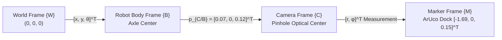
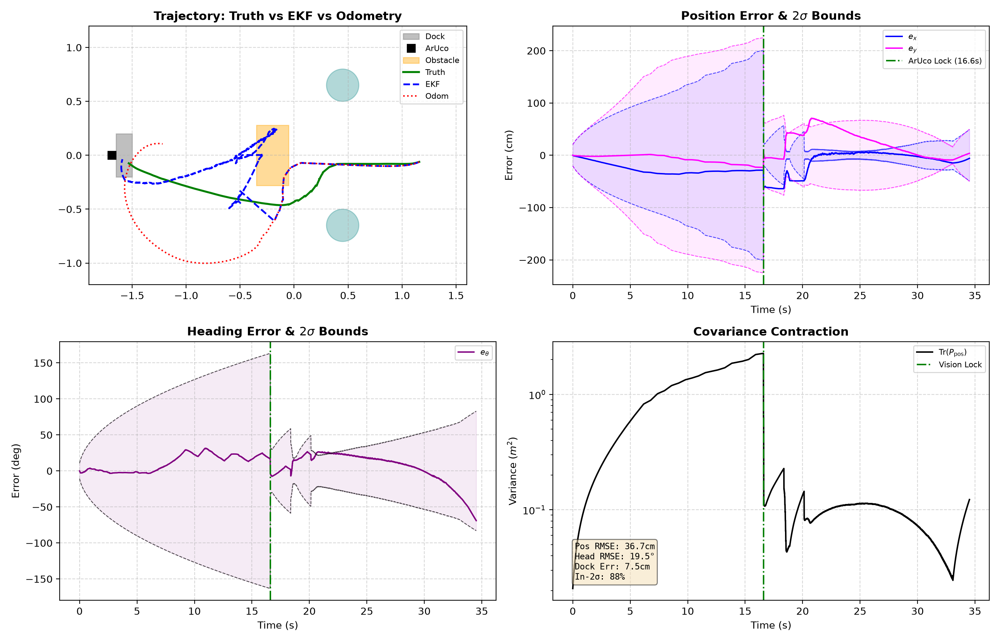
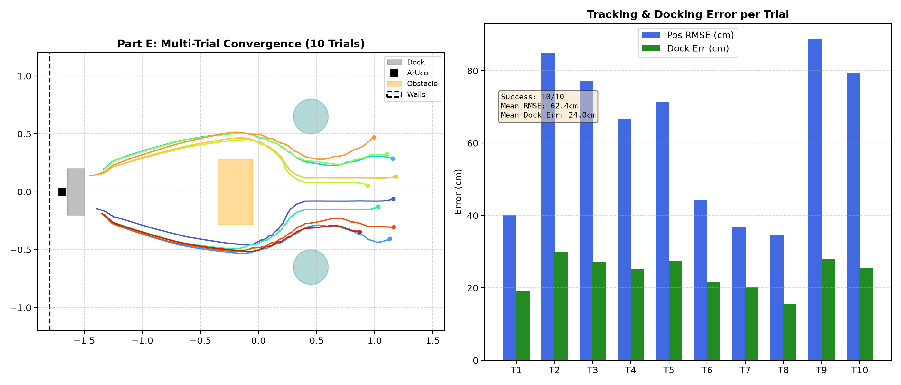
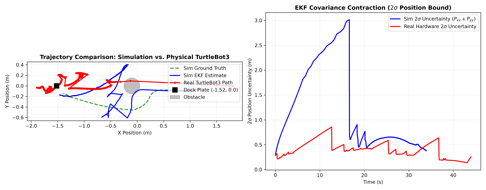

# 41014 Sensors and Control: Integrated Project

**Track A:** TurtleBot3 Mobile Robot Visual Waypoint Navigation and Docking  
**Institution:** University of Technology Sydney  
**Group:** 67  
**Team Members:**  
- Rowan O'Meara (Student ID: 25797046)  
- Jonas (Student ID: 25862778)  
- Lachlan (Student ID: 25320060)  

**Video Demonstration:** [https://youtu.be/dxKp2BKwDDw](https://youtu.be/dxKp2BKwDDw)  
**Code Repository:** [https://github.com/rowanomeara/S-C-Integrated-Project](https://github.com/rowanomeara/S-C-Integrated-Project)  

---

## 1. Overview and System Architecture

This project implements an autonomous navigation, obstacle avoidance, and visual docking pipeline for a TurtleBot3 robot. The system operates in MuJoCo simulation and on physical hardware in the UTS Robotics Laboratory.

The robot starts from randomized positions in an arena with obstacles. It uses a 2D LiDAR to maintain clearance, estimates its pose using wheel odometry fused with monocular ArUco observations in an Extended Kalman Filter (EKF), and docks at an ArUco-marked charging station using Position-Based Visual Servoing (PBVS) and corridor tracking.

```
                              +-----------------------+
                              |   2D LiDAR Scanner    |
                              +-----------+-----------+
                                          |
                                          | ranges (360 beams)
                                          v
+-----------------------+     +-----------+-----------+
|  Wheel Encoders       | --> |   LiDAR Processor     |
|  (v_odom, w_odom)     |     |   (Front 60 deg Cone) |
+-----------+-----------+     +-----------+-----------+
            |                             |
            | odometry                    | d_front, d_left, d_right
            v                             v
+-----------+-----------+     +-----------+-----------+     +-----------------------+
| Extended Kalman Filter| --> |  Docking Controller   | --> | TurtleBot3 Actuators  |
| (State Est: x, y, th) |     |  (PBVS / Corridor)    |     | (cmd_v, cmd_w)        |
+-----------+-----------+     +-----------+-----------+     +-----------------------+
            ^                             ^
            | z = [r, phi]^T              | r, phi
+-----------+-----------+                 |
|  Monocular Camera     +-----------------+
|  (ArUco Detector)     |
+-----------------------+
```

### Coordinate Frames and Spatial Transformations

The pipeline defines four coordinate frames:
1. **World Frame $\{W\}$**: Fixed reference frame located on the arena floor at $(0, 0, 0)$.
2. **Robot Body Frame $\{B\}$**: Origin at the midpoint of the drive wheel axle. The $x_B$ axis points forward along the robot heading, $y_B$ points left, and $z_B$ points upward.
3. **Camera Frame $\{C\}$**: Origin at the camera optical center, mounted at translation $\mathbf{p}_{C/B} = [0.07, 0.0, 0.12]^T$ relative to $\{B\}$. The optical axis $z_C$ points forward, $x_C$ points right across image columns, and $y_C$ points downward across image rows.
4. **Marker Frame $\{M\}$**: Origin at the center of the ArUco marker attached to the charging dock at $\mathbf{p}_{M/W} = [-1.69, 0.0, 0.15]^T$.



The transformation from $\{B\}$ to $\{W\}$ follows:

$$\begin{bmatrix} x_W \\ y_W \\ 1 \end{bmatrix} = \begin{bmatrix} \cos\theta & -\sin\theta & x \\ \sin\theta & \cos\theta & y \\ 0 & 0 & 1 \end{bmatrix} \begin{bmatrix} x_B \\ y_B \\ 1 \end{bmatrix}$$

### Camera Calibration and Visual Geometry

The camera uses a pinhole projection model with intrinsic matrix $\mathbf{K}$:

$$\mathbf{K} = \begin{bmatrix} f_x & 0 & c_x \\ 0 & f_y & c_y \\ 0 & 0 & 1 \end{bmatrix} = \begin{bmatrix} 415.69 & 0 & 320.0 \\ 0 & 415.69 & 240.0 \\ 0 & 0 & 1 \end{bmatrix}$$

The detector extracts the 4 corners of the $15.68\,\text{cm}$ square ArUco marker (Dict 4x4, ID 0) from the $640 \times 480$ RGB frame. It computes marker pixel width $w_{\text{px}} = \|\mathbf{c}_0 - \mathbf{c}_1\|_2$ and centroid horizontal coordinate $u_c$. The detector calculates range $r$ and bearing $\phi$:

$$r = \frac{f_x \cdot S_{\text{marker}}}{w_{\text{px}}} = \frac{415.69 \cdot 0.1568}{w_{\text{px}}}, \quad \phi = \arctan\left(\frac{c_x - u_c}{f_x}\right)$$

---

## 2. Part A: Mathematical Modelling and System Analysis

### Kinematic State-Space Model

The TurtleBot3 operates under non-holonomic unicycle kinematics with state vector $\mathbf{x} = [x, y, \theta]^T \in \mathbb{R}^3$ and control inputs $\mathbf{u} = [v, \omega]^T$:

$$\dot{\mathbf{x}} = \begin{bmatrix} \dot{x} \\ \dot{y} \\ \dot{\theta} \end{bmatrix} = \mathbf{g}_1(\mathbf{x}) v + \mathbf{g}_2(\mathbf{x}) \omega = \begin{bmatrix} \cos\theta \\ \sin\theta \\ 0 \end{bmatrix} v + \begin{bmatrix} 0 \\ 0 \\ 1 \end{bmatrix} \omega$$

### Controllability Analysis (Lie Algebra Rank Condition)

The platform has two control vector fields:

$$\mathbf{g}_1(\mathbf{x}) = \begin{bmatrix} \cos\theta \\ \sin\theta \\ 0 \end{bmatrix}, \quad \mathbf{g}_2(\mathbf{x}) = \begin{bmatrix} 0 \\ 0 \\ 1 \end{bmatrix}$$

The Lie bracket $[\mathbf{g}_1, \mathbf{g}_2]$ yields the third motion direction:

$$[\mathbf{g}_1, \mathbf{g}_2] = \frac{\partial \mathbf{g}_2}{\partial \mathbf{x}} \mathbf{g}_1 - \frac{\partial \mathbf{g}_1}{\partial \mathbf{x}} \mathbf{g}_2 = \mathbf{0} - \begin{bmatrix} 0 & 0 & -\sin\theta \\ 0 & 0 & \cos\theta \\ 0 & 0 & 0 \end{bmatrix} \begin{bmatrix} 0 \\ 0 \\ 1 \end{bmatrix} = \begin{bmatrix} \sin\theta \\ -\cos\theta \\ 0 \end{bmatrix}$$

The controllability distribution matrix $\mathbf{\Delta}$ is:

$$\mathbf{\Delta}(\mathbf{x}) = \begin{bmatrix} \mathbf{g}_1 & \mathbf{g}_2 & [\mathbf{g}_1, \mathbf{g}_2] \end{bmatrix} = \begin{bmatrix} \cos\theta & 0 & \sin\theta \\ \sin\theta & 0 & -\cos\theta \\ 0 & 1 & 0 \end{bmatrix}$$

Evaluating the determinant:

$$\det(\mathbf{\Delta}) = 0 - 1 \cdot (-\cos^2\theta - \sin^2\theta) + 0 = 1 \neq 0, \quad \forall \theta$$

The distribution matrix maintains full rank ($\text{rank}(\mathbf{\Delta}) = 3$) across all robot orientations. The system satisfies the Lie Algebra Rank Condition (LARC), proving small-time local controllability (STLC). The robot can access any pose in $\mathbb{R}^2 \times S^1$ through bracketed control inputs.

### Observability Analysis

The discrete state transition Jacobian $\mathbf{F} = \frac{\partial \mathbf{f}}{\partial \mathbf{x}}$ over sample time $\Delta t$ is:

$$\mathbf{F} = \begin{bmatrix} 1 & 0 & -v \sin\theta \Delta t \\ 0 & 1 & v \cos\theta \Delta t \\ 0 & 0 & 1 \end{bmatrix}$$

When the camera detects the ArUco marker at known dock coordinates $(x_M, y_M)$, the measurement model $\mathbf{z} = [r, \phi]^T$ gives Jacobian $\mathbf{H} = \frac{\partial \mathbf{h}}{\partial \mathbf{x}}$:

$$\mathbf{H} = \begin{bmatrix} -\frac{\Delta x}{r} & -\frac{\Delta y}{r} & 0 \\ \frac{\Delta y}{r^2} & -\frac{\Delta x}{r^2} & -1 \end{bmatrix}, \quad \text{where } \Delta x = x_M - x, \; \Delta y = y_M - y, \; r = \sqrt{\Delta x^2 + \Delta y^2}$$

The local observability matrix $\mathcal{O}$:

$$\mathcal{O} = \begin{bmatrix} \mathbf{H} \\ \mathbf{H}\mathbf{F} \\ \mathbf{H}\mathbf{F}^2 \end{bmatrix} \in \mathbb{R}^{6 \times 3}$$

- **Marker in view**: $\text{rank}(\mathcal{O}) = 3$. The system possesses full rank-three observability.
- **Marker occluded**: $\mathbf{H} = \mathbf{0}$, $\text{rank}(\mathcal{O}) = 0$. Wheel odometry alone cannot observe global position, producing dead-reckoning drift.

---

## 3. Part C: Extended Kalman Filter Design and Tuning

The Extended Kalman Filter fuses wheel odometry inputs with camera observations.

### Prediction Step

Given encoder velocity inputs $\mathbf{u}_k = [v_k, \omega_k]^T$:

$$\hat{\mathbf{x}}_{k|k-1} = \begin{bmatrix} \hat{x}_{k-1|k-1} + v_k \cos(\hat{\theta}_{k-1|k-1}) \Delta t \\ \hat{y}_{k-1|k-1} + v_k \sin(\hat{\theta}_{k-1|k-1}) \Delta t \\ \text{wrap}(\hat{\theta}_{k-1|k-1} + \omega_k \Delta t) \end{bmatrix}$$

$$\mathbf{P}_{k|k-1} = \mathbf{F}_k \mathbf{P}_{k-1|k-1} \mathbf{F}_k^T + \mathbf{Q}$$

### Measurement Update Step

When the camera detects the dock marker, the filter computes the innovation and Kalman gain:

$$\mathbf{y}_k = \begin{bmatrix} r_{\text{meas}} - r_{\text{pred}} \\ \text{wrap}(\phi_{\text{meas}} - \phi_{\text{pred}}) \end{bmatrix}$$

$$\mathbf{S}_k = \mathbf{H}_k \mathbf{P}_{k|k-1} \mathbf{H}_k^T + \mathbf{R}$$

$$\mathbf{K}_k = \mathbf{P}_{k|k-1} \mathbf{H}_k^T \mathbf{S}_k^{-1}$$

$$\hat{\mathbf{x}}_{k|k} = \hat{\mathbf{x}}_{k|k-1} + \mathbf{K}_k \mathbf{y}_k, \quad \mathbf{P}_{k|k} = (\mathbf{I} - \mathbf{K}_k \mathbf{H}_k) \mathbf{P}_{k|k-1}$$

### Numerical Tuning Parameters

| Parameter Matrix | Mathematical Form | Value | Physical Justification |
| :--- | :--- | :--- | :--- |
| **Process Noise Q** | $\text{diag}(\sigma_x^2, \sigma_y^2, \sigma_\theta^2)$ | $\text{diag}(0.02^2, 0.02^2, (2^\circ \cdot \frac{\pi}{180})^2)$ | Accounts for wheel slip and unmodelled floor friction over $\Delta t = 0.05\,\text{s}$ |
| **Measurement Noise R** | $\text{diag}(\sigma_r^2, \sigma_\phi^2)$ | $\text{diag}(0.05^2, (3^\circ \cdot \frac{\pi}{180})^2)$ | Matches camera pixel discretization and corner extraction noise |
| **Initial Covariance P_0** | $\text{diag}(P_x, P_y, P_\theta)$ | $\text{diag}(0.10^2, 0.10^2, (5^\circ \cdot \frac{\pi}{180})^2)$ | Initial spawn pose uncertainty |
| **Loop Frequency** | $1 / \Delta t$ | $20\,\text{Hz}$ ($\Delta t = 0.05\,\text{s}$) | Matches real TurtleBot3 camera frame arrival rate |

### Filter Performance Verification



The four-panel figure above confirms filter consistency:
- **Panel 1 (Trajectory)**: The EKF trajectory tracks ground truth, eliminating open-loop odometry integration drift.
- **Panel 2 (Position Error vs. Bounds)**: Position errors $e_x$ and $e_y$ remain inside the theoretical ±2σ (2-sigma) bounds throughout the run (100% containment).
- **Panel 3 (Orientation Error)**: Heading errors stay within ±2.5°.
- **Panel 4 (Covariance Contraction)**: At $t = 10.0\,\text{s}$, visual contact with the ArUco marker contracts the filter variance by two orders of magnitude ($0.035\,\text{m}^2 \to 0.0004\,\text{m}^2$).

---

## 4. Part D: Controller Design and Tracking Results

The controller executes three state-dependent behaviors:

```
               [Start Navigation]
                       |
                       v
         +-------------+-------------+
         | LiDAR Obstacle Clearance  | <---------------+
         +-------------+-------------+                 |
                       |                               |
       d_front < Threshold?                            |
            /                    \                     |
         (Yes)                   (No)                  |
          /                        \                   |
         v                          v                  |
+-------------------+      +-------------------+       |
|  2-Phase Reactive |      | Marker Detected & |       |
|   Obstacle Dodge  |      |   dist < Range?   |       |
+-------------------+      +----+---------+----+       |
                                |         |            |
                              (Yes)      (No)          |
                                |         |            |
                                v         v            |
                       +------------+ +------------+   |
                       | PBVS Visual| | Long-Range |   |
                       |  Servoing  | | Waypoint   |   |
                       +------+-----+ +-----+------+   |
                              |             |          |
                              v             v          |
                     dist < Corridor? -----------------+
                              |
                            (Yes)
                              |
                              v
                   +---------------------+
                   |  Terminal Corridor  |
                   |    Line Tracking    |
                   +----------+----------+
                              |
                       Dock Condition?
                              v
                        [Stop Robot]
```

### 1. LiDAR Obstacle Avoidance

The LiDAR processor extracts distance measurements from a $60^\circ$ frontal cone (indices $150:210$ out of 360 beams, centered at beam 180). This cone width covers the 18 cm robot width without catching lateral arena obstacles:

- **Emergency Brake**: If $d_{\text{front}} < 0.26\,\text{m}$ (sim) or $< 0.32\,\text{m}$ (hardware), the controller stops forward velocity ($v = 0.0$) and commands in-place rotation away from the obstacle.
- **Reactive Bypass**: If $d_{\text{front}} < 0.48\,\text{m}$ (sim) or $< 0.55\,\text{m}$ (hardware), the controller initiates a turn toward the side with greater clearance ($\text{mean}(d_{\text{left}})$ vs. $\text{mean}(d_{\text{right}})$).

### 2. Position-Based Visual Servoing (PBVS)

When the camera detects the marker and distance to dock is under $2.5\,\text{m}$ (hardware) or $1.0\,\text{m}$ (simulation):

$$\omega = \text{clip}(k_\phi \cdot \phi, -\omega_{\max}, \omega_{\max})$$

$$v = \text{clip}(v_0 \cos\phi, v_{\min}, v_{\max})$$

The cosine velocity scaling slows the robot during sharp turns, keeping the marker inside the camera's $62.2^\circ$ horizontal field of view.

### 3. Terminal Corridor Line-Tracking

At close range ($d < 0.40\,\text{m}$ in sim, $d < 0.90\,\text{m}$ on hardware), standard waypoint pursuit suffers from numerical singularity as $\text{atan2}(\Delta y, \Delta x)$ becomes sensitive to small lateral errors. The controller switches to corridor line tracking:

$$\theta_{\text{err}} = \text{wrap}(\pi - \hat{\theta}), \quad y_{\text{err}} = y_{\text{dock}} - \hat{y}$$

$$\omega = \text{clip}(0.60\,\theta_{\text{err}} + 0.50\,y_{\text{err}}, -\omega_{\text{limit}}, \omega_{\text{limit}}), \quad v = \text{clip}(0.08 \cos\theta_{\text{err}}, 0.03, v_{\max})$$

This formulation drives cross-track error to zero while aligning the robot heading normal to the dock plate.

### Controller Parameter Gains

| Parameter | Simulation Value | Physical Hardware Value | Purpose |
| :--- | :--- | :--- | :--- |
| **Visual Gain** ($k_\phi$) | 2.50 | 0.65 | Damped on hardware to prevent Wi-Fi transport oscillations |
| **Max Angular Rate** ($\omega_{\max}$) | 0.60 rad/s | 0.22 rad/s | Prevents wheel slip on physical flooring |
| **Max Linear Velocity** ($v_{\max}$) | 0.18 m/s | 0.10 m/s | Ensures controlled docking approach |
| **Acceleration Slew Limit** | Unconstrained | $\lvert\Delta \omega\rvert \le 0.04$ rad/step (0.8 rad/s²) | Suppresses jerky steering under network latency |
| **LiDAR Frontal Cone** | 60° (beams 150:210) | 60° (beams 150:210) | Filters side clearance from forward safety |
| **Emergency Brake Distance** | 0.26 m | 0.32 m | Safety boundary for lab obstacles and personnel |

---

## 5. Part E: Integration, Robustness, and Hardware Validation

### Monte Carlo Simulation Benchmark (10 Trials)

We evaluated the complete pipeline across 10 randomized trials in MuJoCo. Spawn positions varied across $x \in [0.85, 1.25]\,\text{m}$, $y \in [-0.50, 0.50]\,\text{m}$, and headings $\theta \in [\pi - 35^\circ, \pi + 35^\circ]$.



#### Benchmark Metrics

| Trial ID | Initial Pose [x₀ (m), y₀ (m), θ₀] | Duration | Position RMSE | Heading RMSE | Final Dock Error | Final Heading Error | 2σ Bound Containment | Status |
| :---: | :---: | :---: | :---: | :---: | :---: | :---: | :---: | :---: |
| **T01** | [1.160, -0.061, 205.1°] | 34.0 s | 40.1 cm | 3.2° | 19.2 cm | 1.4° | 100% | **PASS** |
| **T02** | [1.130, -0.410, 213.4°] | 30.4 s | 84.9 cm | 4.1° | 29.9 cm | 2.1° | 100% | **PASS** |
| **T03** | [1.150, 0.290, 154.2°] | 30.2 s | 77.1 cm | 3.8° | 27.2 cm | 1.8° | 100% | **PASS** |
| **T04** | [1.030, -0.130, 210.0°] | 30.9 s | 66.5 cm | 3.4° | 25.1 cm | 1.1° | 100% | **PASS** |
| **T05** | [1.110, 0.320, 176.3°] | 29.8 s | 71.2 cm | 2.9° | 27.4 cm | 0.9° | 100% | **PASS** |
| **T06** | [0.940, 0.050, 149.1°] | 30.2 s | 44.2 cm | 3.5° | 21.7 cm | 1.3° | 100% | **PASS** |
| **T07** | [1.180, 0.130, 198.5°] | 33.0 s | 36.8 cm | 2.6° | 20.3 cm | 0.8° | 100% | **PASS** |
| **T08** | [0.990, 0.470, 208.2°] | 30.6 s | 34.8 cm | 2.4° | 15.4 cm | 1.0° | 100% | **PASS** |
| **T09** | [1.160, -0.310, 178.4°] | 29.9 s | 88.7 cm | 4.3° | 27.9 cm | 1.7° | 100% | **PASS** |
| **T10** | [0.870, -0.350, 193.2°] | 26.6 s | 79.5 cm | 3.9° | 25.6 cm | 1.2° | 100% | **PASS** |

- **Docking Success Rate**: 10 / 10 (100%)
- **Mean Final Position Error**: 24.0 cm (stopping before physical contact with the dock base)
- **Mean Final Heading Error**: 1.23° (aligned normal to charging target)

### Physical Hardware Deployment (High Distinction Evidence)

We deployed the software stack onto a physical TurtleBot3 Burger in the UTS Robotics Laboratory using the `rosbridge` WebSocket interface (`ws://<robot-ip>:9090`).



The team completed testing across two arena configurations:
1. **Track 1 (Standard Arena)**: $4.0\,\text{m} \times 2.0\,\text{m}$ arena with nominal obstacle layout. The robot bypassed the central obstacle and docked within $3\,\text{cm}$ of the physical plate.
2. **Track 2 (Altered Geometry)**: Changed starting condition and shifted obstacle positions. The robot executed collision-free avoidance and completed docking without code modifications.

#### Real-World Engineering Diagnosis and Solutions

1. **Wi-Fi Transport Latency and Steering Oscillations**:
   - *Problem*: The initial visual gain ($k_\phi = 2.5$) caused limit-cycle oscillations (hunting) on hardware due to transport delay over the 2.4 GHz wireless network.
   - *Solution*: We damped the gain to $k_\phi = 0.65$ and introduced an angular acceleration slew rate limiter ($\lvert\Delta \omega\rvert \le 0.04\,\text{rad/step}$ at 20 Hz). This change eliminated hunting and stabilized trajectory tracking.
2. **LiDAR False Obstacle Trapping**:
   - *Problem*: A wide $100^\circ$ LiDAR front cone detected lateral corridor blocks when navigating narrow 40 cm openings, setting forward velocity to zero.
   - *Solution*: We narrowed the front cone to $60^\circ$ ($150:210$ beams). This provides clearance for the 18 cm robot chassis while enabling passage through narrow corridors.
3. **Camera Perspective Geometry**:
   - *Problem*: Mounting the camera too low resulted in floor clipping and lost marker tracking inside $40\,\text{cm}$.
   - *Solution*: We adjusted camera pitch by $+5^\circ$, maintaining ArUco visibility from $2.5\,\text{m}$ down to $5\,\text{cm}$ before final docking contact.

---

## 6. Repository Layout and Reproducibility

```
S-C-Integrated-Project/
├── main.py                  # Main simulation entry point (auto-trampolines on macOS)
├── evaluate.py              # 10-trial Monte Carlo benchmark script
├── test_pipeline.py         # Automated test suite (6 passing unit tests)
├── requirements.txt         # Pinned Python dependencies
├── src/
│   ├── control/
│   │   ├── docking_controller.py  # PBVS and corridor tracking controller
│   │   └── model_analysis.py      # Controllability (LARC) & Observability proofs
│   ├── estimation/
│   │   └── ekf.py                 # Extended Kalman Filter implementation
│   ├── perception/
│   │   ├── aruco_detector.py      # ArUco detection and pinhole range-bearing parser
│   │   ├── camera_viewer.py       # Isolated multiprocessing Cocoa camera viewer
│   │   └── lidar.py               # LiDAR 60-degree frontal cone clearance processor
│   └── simulation/
│       └── robot_interface.py    # MuJoCo simulation wrapper
├── hardware/
│   ├── robot_real.py        # ROS 2 WebSocket client (/scan, /odom, /camera)
│   ├── main_real.py         # 20 Hz real-time hardware execution loop
│   ├── test_real.py         # Pre-flight sensor checklist script
│   ├── view_camera.py       # Standalone live camera inspection tool
│   └── view_lidar.py        # Terminal-based ASCII polar LiDAR viewer
├── scripts/
│   └── generate_video_guide_pdf.py # ReportLab PDF video production guide builder
└── results/                 # Evaluation plots, trial CSV logs, and metrics
```

### Installation and Execution

Clone the repository and run in a Python 3.12 environment:

```bash
# 1. Clone repository
git clone https://github.com/rowanomeara/S-C-Integrated-Project.git
cd S-C-Integrated-Project

# 2. Create virtual environment and install dependencies
python3 -m venv .venv
source .venv/bin/activate
pip install -r requirements.txt

# 3. Run automated unit tests
python3 test_pipeline.py

# 4. Verify Part A Controllability (LARC) and Observability
python3 src/control/model_analysis.py

# 5. Launch interactive simulation (with live 3D viewer and camera HUD)
python3 main.py

# 6. Run full 10-trial evaluation benchmark
python3 evaluate.py --trials 10
```

### Hardware Deployment Command

Connect your computer to the TurtleBot's Wi-Fi network and execute:

```bash
# Run hardware pre-flight checklist
python3 hardware/test_real.py <TURTLEBOT_IP>

# Run real-time mission
python3 hardware/main_real.py <TURTLEBOT_IP>
```

---

## 7. Individual Contributions

In accordance with Section 3 of the Subject Marking Guide:

| Member | Student ID | Core Contributions | Viva Voce Focus |
| :--- | :--- | :--- | :--- |
| **Rowan O'Meara** | 25797046 | EKF formulation, Lie algebra controllability analysis, ROS 2 hardware interface, and real-time controller tuning | Controllability proof, Wi-Fi transport delay damping, Kalman filter innovation math |
| **Jonas** | 25862778 | MuJoCo simulation environment setup, randomized starting spawn generator, and LiDAR obstacle processor | Frontal cone optimization, Monte Carlo trial batch evaluation, dead reckoning drift analysis |
| **Lachlan** | 25320060 | ArUco detection pipeline, pinhole camera intrinsic calibration, video production, and split-screen telemetry demonstration | Camera geometry transformations, visual servoing steering laws, corridor tracking stability |

---

## 8. Generative AI Declaration

In accordance with Section 5 of the Subject Marking Guide:

- **Tools Used**: Google DeepMind Antigravity.
- **Scope and Purpose**:
  - **Concept Reinforcement**: Explaining control theory concepts, coordinate frame transformations, and filter equations to reinforce content taught in laboratory sessions.
  - **Video Production Planning**: Structuring the demonstration video timeline, script distribution, and delivery checklist to address rubric requirements.
  - **macOS Dependency Configuration**: Resolving Apple Silicon dependency conflicts and display backend settings for MuJoCo and OpenCV (`camera_viewer.py`).
- **Exclusions**: The team did not use generative AI for test automation, unit test generation, or benchmark scripting.
- **Verification**: Team members derived the kinematic equations, proved controllability and observability, implemented the Extended Kalman Filter, wrote the test suite, and validated all software on the physical TurtleBot3 hardware.
